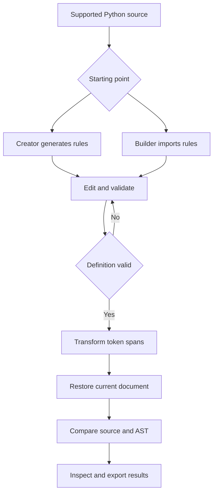

# Coursework notes — code-only scope

Working title: **ΠRIME: A Python Workbench for Custom Code Languages and Reversible Source Obfuscation**.

Audience: application-security researchers investigating source-code representation and obfuscation. Problem: create/import an explicit custom token system, apply it consistently to supported code, and check correctness and exposed patterns. The proposed workflow's value needs validation with target users; it is not an established market finding.

## Dataset description

`prime/dataset.py` defines 16 synthetic Python fixtures, exported in `data/synthetic_corpus.json`. They were authored for software testing, not collected from users. No proprietary code is included. Teacher acceptance of a constructed dataset is still pending.

| Group | Count | Features |
|---|---:|---|
| P01–P10 | 10 | Output, conditions, loops, functions, strings/comments, collections, Unicode, line endings and multiline literals. |
| N01–N06 | 6 | Invalid syntax, imports, attribute calls, f-strings, classes and empty input. |

Fields: `id`, `kind` (always Python), feature `label` and original `source`. Fixed trusted programs have `expected` output for a separate test. Negative examples have `expect_error: true`.

## Preprocessing and analysis actually performed

1. Validate type, source character limit and valid UTF-8 representation.
2. Preserve case, Unicode, comments, punctuation and whitespace exactly. Do not destructively normalise or strip the original source.
3. Use `ast.parse` to validate the declared subset and complexity limits; use `tokenize.generate_tokens` to locate selected source token spans.
4. Extract unique category/spelling pairs in first-occurrence order. Preserve exact gaps between them, including CRLF and tabs.
5. Check unique aliases, valid boundaries, coverage, policy and PNG attachment limits. Reject duplicate aliases; warn about duplicate visual attachments.
6. Replace selected token spans with framed aliases; escape literal framing characters.
7. Restore source by reverse mapping. Compare exact characters, first difference and Python AST structure.
8. Measure conversion durations, bytes and repeated tokens. Keep deliberate negative cases separate from supported-input recovery results.

This is parsing, validation, transformation and descriptive analysis. There is no AI training or automatic image decipherment.

## Experiment design

Three families: ASCII tokens, word tokens and geometric tokens. Each supported fixture is tested under both full and names/operators policies. Each negative fixture uses the full policy.

- One repetition: `10 × 3 × 2 = 60` valid + `6 × 3 = 18` negative = 78 total.
- Three repetitions: 180 valid + 54 negative = 234 total.
- Five repetitions: 300 valid + 90 negative = 390 total.

The repetition index seeds mapping generation. Timings remain machine-dependent. Exact recovery uses supported-input trials as its denominator. Negative examples are expected scope rejections, not failed supported-input recoveries.

`encode_ms` includes validation and encoding. `decode_ms` includes restoration, comparison and AST checks. `trial_ms` also includes definition generation. Browser/network overhead is excluded. Byte expansion includes the header and framing. Medians mix different fixtures and policies; small timing differences do not establish a robust performance advantage.

The included experiment measured all 180 supported cases recovering exactly, with matching ASTs, and all 54 expected failures being rejected. Rerun on the demonstration machine and cite the generated timestamp/environment in the final report. The app does not execute uploaded programs; only a separate automated test executes the ten fixed trusted fixtures after exact equality checks.

## Algorithm

1. Choose Creator or Builder.
2. Generate candidate rules or import/label an existing notation.
3. Edit and validate the definition before replacing the active one.
4. Parse source, extract token spans and preserve literal gaps.
5. Frame aliases and add a dictionary-compatibility header.
6. Restore with the matching definition; reject malformed/unknown tokens.
7. Check exact equality and AST equality; inspect patterns, bytes and timings.
8. Export the definition and public representation separately.

## Required student deliverables

| Requirement | Available here | Remaining work |
|---|---|---|
| Dataset description | Corpus JSON and this method | Obtain teacher approval. |
| Preprocessing/analysis | Parsing/validation pipeline and Python functions | Explain choices and exact preservation. |
| Function list and algorithms | FUNCTIONS.md and the flowchart above | Understand and explain the implementation. |
| Visualisation | Frequency bars, measured time/size charts, CSV and SVG | Interpret a real rerun. |
| Word document | Material for introduction, dataset, method, results and limitations | Add title, real team names/PRN/batch/division/faculty, format and review. |
| Screenshots | A working app | Capture verified results yourselves. None are fabricated or included here. |
| Existing-solution comparison | Scope for comparison | Research 2–3 tools using current primary sources; do not claim no alternatives exist. |
| Technical contribution | Engine, interface, imports and experiments | Each teammate must implement/test/explain real technical work. Slides/report alone are insufficient. |
| GitHub history | Source and .gitignore | Create/use the team's repository and make genuine development commits. |

The separate earlier team briefing remains unchanged. SCOPE.md records the revised audience; its broader earlier audience assumptions are superseded.

## Conclusion boundaries

Passing fixture tests supports demonstrated recovery and validation. It does not establish support for unrestricted Python, a new interpreter, cryptographic confidentiality, resistance to determined reverse engineering, production protection, professional adoption or a completed user study. Document those limits and propose focused next steps.
