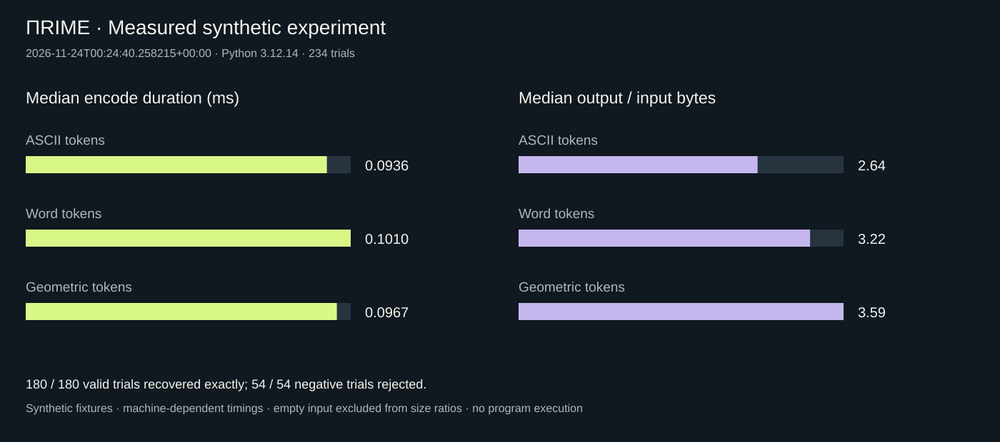

# Measured experiment results

Generated: 2026-11-24T00:24:40.258215+00:00 (UTC).

Environment: Python 3.12.14, Linux.

16 fixtures × applicable configurations × 3 repetitions = 234 actual trials.

- Valid trials: 180; exact recoveries: 180.
- Deliberate negative trials: 54; correct rejections: 54.

| Family | Valid trials | Exact | Median encode (ms) | Median byte expansion |
|---|---:|---:|---:|---:|
| ascii | 60 | 60 | 0.09360 | 2.64× |
| syllables | 60 | 60 | 0.10101 | 3.22× |
| geometry | 60 | 60 | 0.09670 | 3.59× |

16 synthetic Python fixtures authored for this ΠRIME prototype; no proprietary source code. Teacher acceptance of this constructed dataset is pending.

No program was executed by this benchmark. Exact recovery and Python AST equality are measured. Trusted demonstration execution is tested separately by the automated test suite.

Encode time includes validation and conversion. Decode time includes recovery/comparison and Python AST checks. Total trial time also includes key creation. All are Python-side durations; browser/network overhead is excluded.

Byte expansion includes the version header, escaping and token frames. Zero-byte inputs are excluded from ratios. Family medians mix fixture categories and policies. A three-repetition run is a demonstration, not a statistically rigorous performance study.

No user study, handwriting-speed result, security strength or external benchmark comparison is inferred from these measurements. Rerun on your own machine before preparing the final report.
